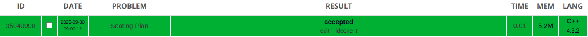

# CFONISMG · Seating Plan

Place students in a rectangular grid and maximize the number of friend pairs who share a side. An occupied edge is forbidden if the two students are rivals or both are disruptive. [SPOJ statement](https://www.spoj.com/problems/CFONISMG/)

[C++ source](code.cpp)

## Problem and input

Read the desk dimensions $R,C$, the student count $N$, then $N$ name/status pairs. The two statuses are `GOODBOY` and `DISRUPTIVE`. The input ends with a count $F$ and its friendship pairs, then a count $V$ and its rivalry pairs. Relationships use student names and are treated as unordered. The official bounds are $1\le R,C\le4$, $1\le N\le RC$, and $0\le F,V\le N(N-1)/2$. Names are unique alphanumeric strings of length 1 through 10. The statement asks for the maximum score or `Impossible` when seating is infeasible.

## From seats to grid edges

A desk is a grid vertex, and a shared side is an undirected edge. Once two students occupy the endpoints of an edge, their relationship determines whether the edge is allowed and whether it scores a point. Each vertical edge has one lower endpoint, and each horizontal edge has one right endpoint. Checking only up and left from each occupied desk therefore visits every occupied edge exactly once.

The input loop assigns IDs in roster order. `getStudentId()` resolves each relationship name by comparing it character by character with the roster. `status[id]` is 1 for a disruptive student, identified by `D` at the start of the status. `grid` holds a student ID or `-1` for a vacant desk. `friends` and `rivals` store pairs of IDs, so checking a layout requires only integer comparisons.

## What the backtracking maximizes

`solve(pos, used)` visits desks in row-major order using `pos / C` and `pos % C`. At each desk it can leave a vacancy or use any currently unused student.

```cpp
grid[r][c] = -1;
solve(pos + 1, used);

for (int i = 0; i < N; i++) {
    if (used[i]) continue;
    used[i] = 1;
    grid[r][c] = i;
    solve(pos + 1, used);
    used[i] = 0;
}
```

At depth `pos`, `used` marks exactly the students in the processed prefix. Assigning a student sets one mark, and backtracking clears it so sibling branches start with the same set of available students. Any layout in which each student appears at most once determines a unique path through these choices.

The recursion reaches a leaf when it has assigned a value to every desk. The vacancy branch lets leaves include layouts with unseated students. `isValid()` rejects a layout if an occupied edge joins two disruptive students or matches a rivalry in either order. At a valid leaf, `countFriends()` scans those same edges for friendship pairs, and `best` keeps the highest score among the valid layouts visited. This enumeration establishes the maximum over the search's partial assignments, which include the full placements.

## Worked example

In the official $2\times2$ example, the friendship pairs are Yij with Johnson and Adam with Marcus. One leaf places Yij and Johnson in the top row, Marcus in the lower-left desk, and a vacancy in the lower-right desk. The top edge scores one point.

Scoring both friendships would place all four students. Adam's rivalry with Yij and shared disruptive status with Johnson would then require both Yij and Johnson to sit diagonally opposite Adam. The grid offers only one such desk, so the maximum score in the search is `1`.

## Complexity

Let $K=RC$. A leaf with $k$ occupied desks chooses those desks in $\binom{K}{k}$ ways and assigns distinct students to them in $N!/(N-k)!$ ways. Summing over occupancy counts gives the number of leaves.

$$
L=\sum_{k=0}^{\min(K,N)} \binom{K}{k}\frac{N!}{(N-k)!}.
$$

Each internal depth has at most $L$ prefixes, and each prefix scans up to $N$ student IDs. The code checks relationships only at leaves, where the grid and pair-list scans cost up to $O(K(1+F+V))$. This gives a search bound of $O(KL(1+N+F+V))$. Resolving the input names takes $O((F+V)N\ell)$ for names of maximum length $\ell$. When $N=K$, fully occupied assignments alone account for $N!$ leaves.

The recursion uses $O(K)$ frames. In an input-sized version of the arrays, student names, relationship pairs, and grid storage take $O(N\ell+F+V+K)$ space. The saved program allocates fixed-capacity arrays.

## Submission evidence


