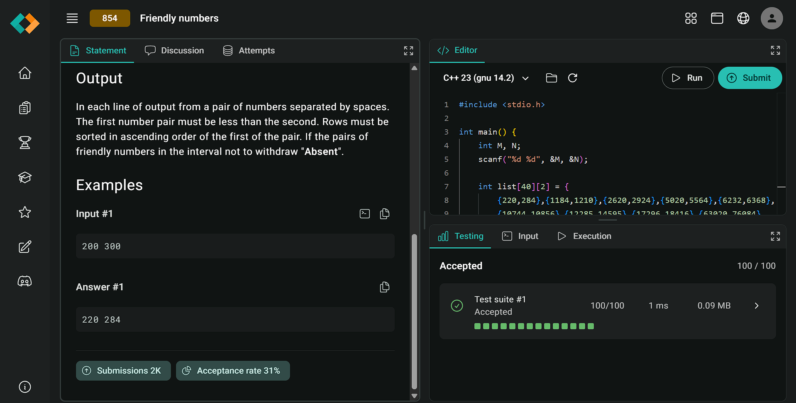

# 854 · Friendly Numbers

List every pair of distinct amicable numbers in the inclusive interval $[M,N]$. Two numbers are amicable when each equals the sum of the other's proper divisors. A proper divisor is positive and smaller than the number it divides. [Eolymp statement](https://eolymp.com/problems/854)

[C++ source](code.cpp)

## Input and output

Read one line with $M$ and $N$, where $1\le M\le N\le1{,}000{,}000$. Print each qualifying pair as two space-separated integers with the smaller value first. Order the lines by their first value, and print `Absent` if the interval contains no complete pair. The published limits are 1 second and 64 MB. The current statement uses the title “Amicable numbers.”

## From divisor sums to a fixed table

Let $s(n)$ denote the sum of the positive proper divisors of $n$. For a pair $(a,b)$ with $a<b$, each number determines the only possible partner. Specifically, $s(a)=b$ and $s(b)=a$. Requiring $a<b$ counts a qualifying pair once and excludes the case where a perfect number maps to itself.

The program stores the 40 pairs whose members both fit in $[1,10^6]$. To derive the full table, start with zero divisor sums. For each $d$, add it to the sums of $2d,3d,\ldots$ up to the bound. An update reaches a number $a$ exactly when $d$ is a positive proper divisor of $a$, so after the pass each sum equals $s(a)$.

Scan $a$ in increasing order and set $b=s(a)$. Keep $(a,b)$ when $a<b\le10^6$ and $s(b)=a$. Every kept entry is amicable by the two sum identities. Every qualifying pair appears when the scan reaches its smaller member. This enumeration yields the 40 entries stored in the source, already in the required order.

## C++ lookup

`list` has capacity for 41 `pair<int,int>` entries, with 40 explicitly initialized and scanned. Their first values are strictly increasing, and each pair already has its smaller value first.

```cpp
int a = list[i].first, b = list[i].second;
if (a >= M && a <= N && b >= M && b <= N) {
    if (a < b) printf("%d %d\n", a, b);
    else printf("%d %d\n", b, a);
    found = 1;
}
```

Both members must pass the inclusive bounds check. The scan preserves the table's order, and `found` stays zero exactly when no pair qualifies. In that case the program prints `Absent` once. The values fit in `int`.

## Worked example

The statement example gives `200 300`. The proper divisors of 220 are $1,2,4,5,10,11,20,22,44,55,110$, which sum to 284. The proper divisors of 284 are $1,2,4,71,142$, which sum to 220. Both numbers in the first table entry lie in the interval, and every later pair starts above 300.

```text
220 284
```

With $N=283$ and the same lower endpoint, the pair is excluded because one member falls outside the range. A singleton interval always gives `Absent`.

## Complexity

For $P=40$ table entries, the scan takes $O(P)$ time and the table uses $O(P)$ space. The program does this fixed work regardless of the query width. Deriving the table offline up to a bound $U$ takes $O(U\log U)$ time, since each divisor $d$ contributes to at most $U/d$ entries, and $O(U)$ space for the divisor sums.

## Submission evidence

The screenshot shows an Accepted run for Eolymp #854 and the example above. The editor uses a two-dimensional integer array. The saved C++ uses an array of pairs with the same lookup approach.


