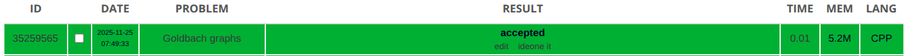

# GOLDG · Goldbach graphs

For each even number $n$, a directed graph has one vertex for each prime $p$ with $1<p<n$. Factor the complement $q=n-p$. Every prime factor of $q$ gives an outgoing edge from $p$ to that factor, with multiplicity in the statement. If $q=1$, the vertex has no outgoing edges. Given a starting number $x$, find the shortest distance to a Goldbach solution vertex. [SPOJ statement](https://www.spoj.com/problems/GOLDG/)

[C++ source](code.cpp)

## Input and output

Read pairs `n x` until a line containing only `0`. The statement guarantees even $2\le n\le 1000$ and $0<x<n$. An eligible start must also be prime. For each pair, print the measured distance or one of the two failure messages.

```text
Solution found at distance D.
Solution not reachable.
x is not a node!
```

## Recognizing a solution vertex

A solution is either a vertex with a single self-edge or a pair of vertices whose only outgoing edges lead to each other. Both cases have the same primality test.

$$
p\text{ belongs to a solution cycle}\quad\Longleftrightarrow\quad n-p\text{ is prime}.
$$

If $q=n-p$ is prime, $p$ has exactly the edge $p\to q$. The complement of $q$ is $p$, also prime, so $q$ has exactly the edge $q\to p$. Equality $p=q$ gives the one-vertex case. Conversely, each solution vertex has one edge counting multiplicity. Its complement therefore has exactly one factor in its prime factorization and is prime. In $GG(6)$, $2\to2$ occurs twice because $6-2=2^2$. The repeated edge can be traversed once, but vertex $2$ fails the primality test for its complement.

## Sieve and implicit BFS

`tabelprima()` initializes `prima` and `faktorprima` for all values through 1,000. It visits prime candidates in ascending order and marks multiples from $i^2$. The first prime to mark a composite is its smallest prime factor. Every composite has a smallest factor no greater than its square root, so it is reached by this loop. A prime retains itself as its own smallest factor.

`proses()` checks that the start is a prime vertex, then tests its complement for a distance-zero answer. When the start is a valid vertex with a nonprime complement, `bfs()` clears `visited`, sets `distance[start] = 0`, and puts the start into the array-backed queue. When it dequeues `p`, it generates its outgoing neighbors from the factorization of `val = n - p`.

```cpp
int faktor = faktorprima[val];
while (val % faktor == 0) val /= faktor;
```

Removing every copy of a factor emits that neighbor once. Parallel edges all reach the same vertex in one step, so folding them together preserves distances. On discovery, BFS marks a vertex and sets its distance to its parent's distance plus one. The queue expands vertices in nondecreasing distance, so the first solution discovered is at the smallest reachable distance. Each vertex is discovered at most once, even on a cycle, and an empty queue means the reachable search space is exhausted.

## Worked example

The official case `38 11` takes two steps.

| Vertex | Complement | Search action |
| ---: | --- | --- |
| 11 | $27=3^3$ | Discover 3 at distance 1. Its complement 35 is composite. |
| 3 | $35=5\cdot7$ | Discover 5 at distance 2. Its complement 33 is composite. Then discover 7 at distance 2. |
| 7, tested on discovery | $31$ is prime | Return distance 2. |

The program prints `Solution found at distance 2.` A start of 7 for $n=38$ returns distance zero. The official `540 33` case is rejected before BFS because 33 is composite.

## Complexity

Let $L=1000$ be the table limit and $V_r$ the number of vertices expanded during a search. The sieve costs $O(L\log\log L)$ time and $O(L)$ space. A BFS clears $O(L)$ entries, then performs at most $O(\log n)$ factor divisions per expanded vertex because each division reduces the remaining complement by at least a factor of two. Its time is $O(L+V_r\log n)$ and its space is $O(L)$, including the queue and distance arrays. Immediate start validation or success at the start skips the BFS entirely.

## Submission evidence


