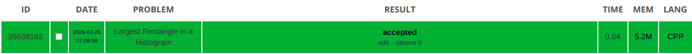

# HISTOGRA · Largest Rectangle in a Histogram

Find the largest rectangle that fits under a sequence of unit-width histogram bars and sits on their common baseline. Bar order matters because the rectangle covers a contiguous interval. [SPOJ statement](https://www.spoj.com/problems/HISTOGRA/)

[C++ source](code.cpp)

## Input and area model

Each case starts with $n$ followed by $n$ heights. The limits are $1\le n\le100{,}000$ and $0\le h_i\le10^9$. A zero in place of $n$ ends the input. Print one maximum area per histogram.

The tallest rectangle over a zero-based interval $[l,r]$ is limited by that interval's shortest bar. Its area is

$$
(r-l+1)\min_{l\le j\le r}h_j.
$$

The minimum is the height of some bar in the interval. Fix a bar and use its height. The widest rectangle at that height containing the bar extends up to the first shorter bar on either side. A monotonic stack records candidates whose right boundary is still unknown and resolves them as the scan encounters shorter bars.

## Monotonic stack and the width at a pop

`h` holds the heights and `arr` is a stack of indices managed by `top`. The indices on the stack increase from bottom to top, and their heights are nondecreasing. A bar remains on the stack until a strictly shorter bar appears on its right.

```cpp
while (top >= 0 && h[arr[top]] > h[i]) {
    int idx = arr[top--];
    int width = (top < 0) ? i : i - arr[top] - 1;
    area = h[idx] * width;
    if (area > maxarea) maxarea = area;
}
arr[++top] = i;
```

When the scan at index $i$ pops `idx`, the current bar is the first strictly shorter bar to its right. Let $b$ be the index exposed by the pop, or $-1$ if the stack is empty. The candidate covers $b+1$ through $i-1$, giving width $i-b-1$. If a bar between $b$ and `idx` were shorter than `idx`, a minimum in that gap would have survived the insertion of `idx` and become a closer predecessor. On the right, every bar up to $i-1$ is tall enough by the pop condition.

Equal heights stay on the stack. As a result, $b$ can have the same height as the popped bar and shorten that candidate's span. Take an optimal positive-area interval, extend it to the first shorter bars, and choose the leftmost minimum-height bar in that span. All earlier bars inside the span are taller and have left the stack by the time this minimum is pushed. Its predecessor is the excluded left boundary, or the stack is empty if the span starts at index zero. When the minimum is popped, its candidate covers the full span. Every evaluated rectangle fits the histogram, so this coverage suffices to recover the maximum.

The code writes a zero sentinel at `h[n]` so all remaining positive heights get popped at the end. Zero-height bars may stay stacked, since their area is zero and `maxarea` starts at zero.

## Worked example

For heights $[2,2,1,3,3,3]$, the bar at index 2 closes the first two height-2 candidates. The scan pops index 1 for area $2\cdot1$, then index 0 for area $2\cdot2$. The three height-3 indices remain on the stack until the sentinel. Their widths are 1, 2, and 3 in pop order. The leftmost height 3 yields the answer $3\cdot3=9$.

```text
6 2 2 1 3 3 3
0
```

```text
9
```

A single bar contributes its own height. An all-zero histogram gives zero. A rising histogram can keep all its positive indices until the sentinel, while a falling histogram typically pops at each step.

## Complexity

Every index is pushed once and popped at most once, so the total time is $O(n)$ per case even if one iteration pops many indices. The heights and stack use $O(n)$ slots, with fixed capacity for 100,001 entries each. The width fits in `int`. The maximum area is $10^{14}$, so `h`, `area`, and `maxarea` use `long long`, and the height operand makes the multiplication 64-bit.

## Submission evidence


