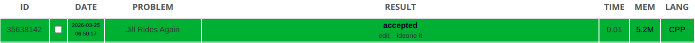

# JRIDE · Jill Rides Again

Choose two stops on a bus route so the sum of the road ratings between them is as large as possible. The ride must be contiguous. A tie goes to the longer ride, then to the earlier starting stop. If every possible ride has a nonpositive score, Jill stays on the bus. [SPOJ statement](https://www.spoj.com/problems/JRIDE/)

[C++ source](code.cpp)

## Input and output

Read the number of routes $b$. Each route has $s$ stops and $s-1$ signed ratings, one per road. Rating $a_i$ belongs to the road from stop $i$ to stop $i+1$. SPOJ allows $2\le s\le100{,}000$ and $|a_i|\le1000$, with nonzero ratings.

Number routes and stops from 1. For route `r`, print `The nicest part of route r is between stops i and j` for a positive best score, or `Route r has no nice parts` otherwise.

## Deriving the scan

Let $P(j)=\sum_{k=1}^{j-1}a_k$ be the total before stop $j$. A ride from stop $i$ to stop $j$ has score

$$
S(i,j)=P(j)-P(i),\qquad 1\le i<j\le s.
$$

For a fixed $j$, maximizing the score is equivalent to minimizing $P(i)$ over earlier stops. If the same minimum occurs more than once, the earliest occurrence gives the longest ride to this endpoint. The program implements this form of Kadane's algorithm without storing the prefix array.

Before reading a road, `currentstart` is the earliest minimum-prefix stop among the starts seen so far. Adding the road's rating to `currentsum` gives the best candidate ending at the next stop. A negative sum means the new endpoint has a strictly smaller prefix, so the scan uses it as the start of the next candidate. At zero, the prefixes tie. Keeping the earlier start gives a longer candidate on any future extension.

## C++ implementation and tie-breaking

The loop reads one rating into `n`. The road at zero-based index `i` ends at one-based stop `i + 2`, so the code sets `currentj = i + 2`. The length is the number of roads, computed as the difference between the endpoints. For each route, `bestsum`, `besti`, and `bestj` store the best segment seen so far.

```cpp
if (currentsum > bestsum || (currentsum == bestsum && currentlen > bestlen)) {
    bestsum = currentsum;
    besti = currentstart;
    bestj = currentj;
}

if (currentsum < 0) {
    currentsum = 0;
    currentstart = i + 2;
}
```

Each endpoint contributes its highest-scoring candidate, with length resolving any tie at that endpoint. The scan compares these candidates by score and length. Because endpoints increase, a later candidate of equal length also starts later. Keeping the existing best when both values tie preserves the earlier start. The output uses the no-nice-parts message if the best score stays at zero.

## Worked example

For an illustrative route with road ratings $[2,-2,3,-8,3,-2,2]$, the first two roads sum to zero. The algorithm keeps stop 1 as a candidate start. The next rating gives a score of 3 between stops 1 and 4, where starting at stop 3 would score the same over only one road. The rating $-8$ then makes the running sum negative and moves the start to stop 5. Roads from stops 5 to 8 also sum to 3 over three roads. The start at stop 1 wins the remaining tie.

```text
The nicest part of route 1 is between stops 1 and 4
```

An all-negative route leaves the best score at zero. An all-positive route extends the best ride to the final stop.

## Complexity

Each road is read once and updates a constant number of values. Time per route is $O(s)$ and auxiliary space is $O(1)$. The statement's bounds give $|S(i,j)|\le 99{,}999\cdot1000<10^8$, which fits the implementation's 32-bit `int`.

## Submission evidence


