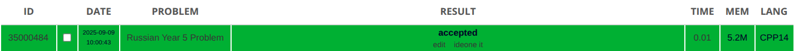

# MGSINFOB · Russian Year 5 Problem

Find two distinct positions whose values add to 100. Print the positions in increasing order using one-based indices. [SPOJ statement](https://www.spoj.com/problems/MGSINFOB/)

[C++ source](code.cpp)

## Input and output

Read $N$ followed by $N$ integers between 1 and 169. The statement gives $N\le10^4$ and promises a unique pair of positions. Print the earlier index on the first line and the later one on the second.

## Finding a complement while reading

For the current value $a_i$, the equation $a_j+a_i=100$ determines the only value that can work at an earlier position $j<i$. Look up $100-a_i$ by value as each new number arrives.

`seen` maps previously read values to their latest zero-based indices. The loop calculates `c = total - a` and checks the map before inserting the current value.

```cpp
if (seen.find(c) != seen.end()) {
    printf("%d\n%d", seen[c]+1, i+1);
    return 0;
}
seen[a] = i;
```

Before index `i`, `seen` contains every distinct value in the prefix, each paired with an index smaller than `i`. A hit therefore supplies two different positions whose values sum to 100. When the scan reaches the later position of the guaranteed pair, the earlier value is already in the map. The addition of 1 to both indices converts them from the loop's zero-based numbering to the requested output.

The lookup happens before the insertion, so a value of 50 can pair with an earlier 50 at another position. After a miss, assigning `seen[a] = i` records the latest position for that value and preserves the prefix invariant.

## Worked example

On the official list `40 60 29`, the lookup for 60 misses while processing 40, so the program records 40 at zero-based index 0. The next value is 60, and the lookup for 40 finds that entry. The program prints positions 1 and 2 and returns.

```text
1
2
```

## Complexity

The scan processes up to $N$ entries with expected $O(1)$ time per hash operation and expected $O(N)$ total time. If $D$ is the number of distinct input values, a general hash-table worst-case bound is $O(ND)$ time and $O(D)$ space. Here $D\le\min(N,169)$, so the small value domain caps the table size and the worst-case lookup chain.

## Submission evidence


