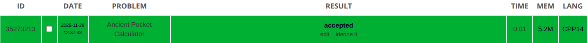

# POCALC1 · Ancient Pocket Calculator

Simulate a pocket calculator from its keystrokes and print the final ten-column display. The calculator commits arithmetic from left to right. Adjacent operators, digit limits, reset, and display rounding all affect the result. [SPOJ statement](https://www.spoj.com/problems/POCALC1/)

[C++ source](code.cpp)

## Input and display rules

Read a positive test count below 1,000, then one sequence per line. Each line contains fewer than 500 keys, written as single-space-separated `[X]` tokens, and ends with `[=]`. Keys include digits, `.`, `+`, `-`, `x`, `:` for division, `=`, and `C`.

Print one right-aligned display per sequence. There are eight digit positions, plus a decimal point and room for a minus sign. The display uses a fixed decimal when the rounded value fits. Scientific notation carries one digit before the decimal point, up to four fractional digits, and a two-digit exponent preceded by a minus sign or a space. The statement specifies zero display for magnitudes at most $10^{-100}$, and `Error.` for division by zero or a rounded magnitude of at least $10^{100}$, including intermediate results.

## Keystrokes and calculator state

The result depends on when each operand is entered. Pressing several operators before entering the next number keeps only the last operator. Keep the accumulated result, the pending operation, and the number being entered as separate pieces of state.

- `accumulator` stores the result of the operands already committed.
- `pendingOp` holds the operator to apply when the current or next operand commits. It starts as `=`, which replaces the accumulator with the operand.
- `value`, `len`, `digits`, `hasDot`, and `active` track the operand under construction.
- `isError` stops evaluation until a reset.

`getNum<int>()` reads the case count with `getchar_unlocked()`. Each case starts with a fresh `Calculator`. In `pressKeys()`, each token contributes the character between its brackets, and a space signals the next token. On `C`, the method sets the key count back to zero. A clear restores the initial calculator state, so the program can replay only the keys after the last clear, including when the discarded prefix would have raised an error.

`resetNumBuilder()` seeds `value` with `"0"` and clears the digit count. In `processKey()`, a digit activates the builder. Leading zero presses leave the stored text as `"0"`. If the decimal point arrives first, the builder counts that initial zero as one of the eight digits, so entering `.5` stores `"0.5"`. The first point sets `hasDot`, which prevents another point from being appended. A trailing point leaves the numeric value unchanged when `strtod` converts it.

```cpp
if (active) {
    double v = strtod(value, nullptr);
    resetNumBuilder();
    accumulator = operate(accumulator, pendingOp, v);
}
pendingOp = k;
```

After each processed key, the builder holds the uncommitted operand and the accumulator holds the result of the operands already applied, in keystroke order. When an operator arrives with an active builder, the old `pendingOp` determines how that operand updates the accumulator. With an inactive builder, the key only changes `pendingOp`. These two cases explain both left-to-right evaluation and why the last of several consecutive operators wins. The final equals commits any remaining operand. Once `operate()` raises the error flag, the replay ends.

## From a number to the display

`operate()` computes with `double`. It flags division by zero and tests the computed magnitude against $10^{100}$. `getDisplay()` first checks the error flag, then uses `checkMinVal()` to decide whether to display zero. Both branches use padded literals. For other values, `getDisplay()` right-aligns the result of `format()` with `%10s`.

For a fixed decimal with $1 \le |x| < 10^8$, let $d$ be the number of integral digits. The precision is $8-d$. For $|x|<1$, the leading zero uses one position, leaving seven fractional digits. `decimalPrecision()` implements this budget as comparisons with powers of ten. `snprintf()` rounds to the selected precision. When the precision is zero, the formatter inserts the decimal point. `decimal()` removes trailing fractional zeros and leaves the point in place.

After the zero check, `format()` selects scientific notation when $|x|<10^{-7}$ or $|x|\ge 10^8$. It formats the magnitude with `%.4e`, which can yield `1.1080e-13`. `scientific()` trims the mantissa to `1.108`, replaces the exponent marker with the display's exponent sign field, and copies the two exponent digits to produce `1.108-13`. For a positive exponent, that sign field is a space. A negative value gets its own minus sign before the mantissa.

## Worked example

The official sequence `[3] [+] [4] [x] [5] [=]` computes $(3+4)\cdot5$. The operator keys change the state as follows.

| Key | Operand committed | Accumulator | Pending operator |
| --- | ---: | ---: | --- |
| `[+]` | 3 | 3 | `+` |
| `[x]` | 4 | 7 | `x` |
| `[=]` | 5 | 35 | `=` |

The final display has seven leading spaces.

```text
       35.
```

On `[1] [:] [0] [=] [C] [2] [.] [5] [+] [.] [5] [=]`, replay begins after `[C]`. The surviving expression adds $2.5$ and $0.5$ and displays `3.`.

## Complexity

For $K$ keys in one sequence, the input pass and suffix replay take $O(K)$ time. Operand conversion and display formatting work on bounded buffers. The 512-byte key buffer and 16-byte number builder give $O(1)$ auxiliary space under the stated key limit. With an adjustable key limit, buffering the suffix would take up to $O(K)$ space.

## Submission evidence


