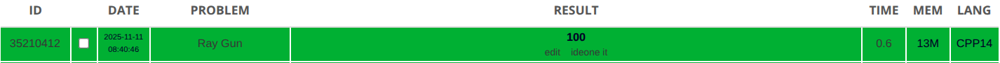

# RAYGUN · Ray Gun

Count how many rays from the origin are needed to cover every other lattice point in the rectangle $0\le x\le m$, $0\le y\le n$. One ray covers every lattice point in the same direction. The task is to count those directions without visiting all $mn$ positive-coordinate points. [SPOJ statement](https://www.spoj.com/problems/RAYGUN/)

[C++ source](code.cpp)

## Input and output

Read a test count $T\le100$, followed by $T$ pairs of nonnegative dimensions. Each dimension is at most $10^9$, and the smaller is at most $10^6$. Cases are numbered from 1. The program prints `Case i: answer` for each one.

## Primitive directions

For $x,y>0$, set $g=\gcd(x,y)$. The point $(x,y)$ lies on the same ray as $(x/g,y/g)$, whose coordinates are coprime. To see why this representative is unique, write it as $(a,b)$ and take another lattice point $(u,v)$ on the ray. Then $av=bu$. Since $a$ and $b$ are coprime, $a$ divides $u$, so both coordinates are the same integer multiple of $(a,b)$. Dividing by $g$ keeps the primitive point inside the rectangle. Counting rays with two positive coordinates therefore amounts to counting coprime pairs in the given ranges. Each nonempty axis contributes one direction.

The Möbius function $\mu(d)$ has value 1 for $d=1$, value 0 if a prime square divides $d$, and value $(-1)^k$ if $d$ is a product of $k$ distinct primes. If an integer $g>1$ has $k$ distinct prime factors, its square-free divisors correspond to subsets of these factors. Summing their signs gives $(1-1)^k=0$. For $g=1$, the only term is 1. Therefore

$$
\sum_{d\mid g}\mu(d)
=\begin{cases}1 & g=1,\\0 & g>1.\end{cases}
$$

Use this Möbius inversion identity as the indicator of $\gcd(x,y)=1$. After exchanging the order of summation, each divisor $d$ contributes once for every pair of positive multiples of $d$ in the rectangle. With $s=\min(m,n)$, the count for positive coordinates becomes

$$
\begin{aligned}
A(m,n)
 &=\sum_{x=1}^{m}\sum_{y=1}^{n}\sum_{d\mid\gcd(x,y)}\mu(d)\\
 &=\sum_{d=1}^{s}\mu(d)\left\lfloor\frac{m}{d}\right\rfloor
                          \left\lfloor\frac{n}{d}\right\rfloor.
\end{aligned}
$$

The result is $A(m,n)+[m>0]+[n>0]$, where each bracket contributes 1 when its condition holds.

## Linear sieve and quotient blocks

The constructor of `MobiusCalculator` uses `minprima` for smallest prime factors, `prima` for the ascending prime list, and `mobius` for the Möbius values. A prime starts with value $-1$. For each $i$, the sieve forms products $ip$ for primes $p$ up to the smallest prime factor of $i$. In that range $p$ is the smallest prime factor of $ip$, so a composite $v$ has one generating pair, with $p$ its smallest prime factor and $i=v/p$.

When $p$ divides $i$, the product contains $p^2$ and its Möbius value is zero. The sieve then stops the inner loop. Otherwise $p$ is a new prime factor, so the code assigns $-\mu(i)$, which also preserves zero for an existing square factor.

Define the Mertens prefix sum by $M(0)=0$ and $M(k)=\sum_{d=1}^{k}\mu(d)$. The `mertens` table represents these prefix sums. In `solve()`, the code swaps the dimensions if needed so `s` is the smaller one. At the start `l` of a block, `a = m / l` and `b = n / l` are the two integer quotients. The first remains $a$ through $\lfloor m/a\rfloor$ and the second remains $b$ through $\lfloor n/b\rfloor$. Capping the smaller endpoint at $s$ gives the last divisor `r` for which both quotients stay fixed.

```cpp
long long totalmobius = (long long)mertens[(int)r]
                     - (long long)mertens[(int)l - 1];
hasil += totalmobius * a * b;
l = r + 1;
```

The prefix difference gives the sum of $\mu(d)$ on the block. Multiplying it by the shared quotient product contributes exactly the original terms for those divisors. Advancing to `r + 1` covers each divisor once. If the smaller dimension is zero, the block loop is skipped and the axis contributions determine the result.

## Worked example

For the official case $m=n=4$, the sieve gives $\mu(1)=1$, $\mu(2)=-1$, $\mu(3)=-1$, and $\mu(4)=0$.

| Divisors in the block | Quotient pair | Sum of Möbius values | Contribution |
| --- | --- | ---: | ---: |
| $[1,1]$ | $(4,4)$ | 1 | 16 |
| $[2,2]$ | $(2,2)$ | -1 | -4 |
| $[3,4]$ | $(1,1)$ | -1 | -1 |

There are $11$ interior directions and two axis directions, producing `Case 1: 13` for the first case. A $0\times n$ rectangle with $n>0$ gives one ray, while a $0\times0$ rectangle gives zero.

## Complexity and integer range

With table limit $L=10^6$, the linear sieve and prefix pass use $O(L)$ time and space. Each query uses constant extra space and takes constant time per block. For a positive integer $u$, there are at most $\sqrt u$ choices of $d$ with $d\le\sqrt u$. Beyond that point, $\lfloor u/d\rfloor$ has at most $\sqrt u$ possible values. Each quotient therefore changes $O(\sqrt u)$ times. A block ends only when at least one of the two quotients changes or the divisor range ends, giving $O(\min(s,\sqrt m+\sqrt n))$ query time for positive dimensions.

The sieve product and the answer use `long long`. The product $mn$ is at most $10^{15}$. Even the sum of absolute interior contributions is bounded by $mn\sum_{d\ge1}1/d^2 \le 2mn$, using $1/d^2\le 1/(d(d-1))$ for $d\ge2$. The table indices stay within $10^6$.

## Submission evidence

The SPOJ screenshot shows a score of 100.


