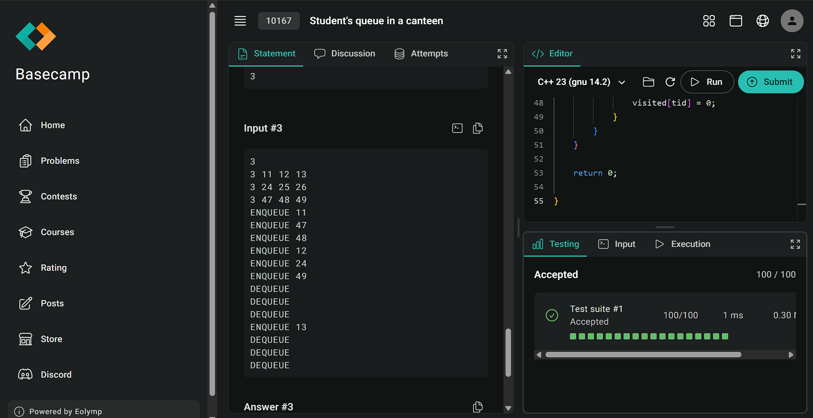

# 10167 · Student's queue in a canteen

A student entering the queue joins the end of their team's group if teammates are already waiting. If the team has no one in line, the student joins the end of the entire queue. A dequeue serves the first waiting student. [Eolymp statement](https://eolymp.com/problems/10167)

[C++ source](code.cpp)

## Input and output

Read the team count $t$, then one roster per team. Each roster starts with its size, followed by its student IDs. There are at most 1,000 teams and 1,000 students per team, and IDs lie between 0 and $10^6$. Each student belongs to one team. The roster is followed by `ENQUEUE x` and `DEQUEUE` commands. The program reads commands until EOF and prints the student ID for every dequeue.

## A queue of team blocks

A team always occupies a contiguous block. A newcomer either appends to the team's existing block or creates a single-student block at the back. A dequeue shortens the front block and removes that block when its last student leaves. Students within a block stay in arrival order.

The implementation uses two levels of queues to maintain this structure.

| C++ state | Meaning |
| --- | --- |
| `steam[sid]` | Team index for student `sid`, initialized from the team rosters |
| `a` | FIFO of teams with at least one waiting student |
| `b[tid]` | FIFO of students waiting in team `tid` |
| `visited[tid]` | Whether team `tid` has an entry in `a` |

The command's first character selects the operation. On enqueue, `steam[sid]` identifies the student's team. If that team has no block in the queue, the program appends its ID to `a` and sets its presence flag. It then pushes the student onto `b[tid]`.

```cpp
if (visited[tid] == 0) {
    a.push(tid);
    visited[tid] = 1;
}
b[tid].push(sid);
```

On dequeue, `a.front()` selects the first block and `b[tid].front()` gives its first student. After printing and popping that student, the program removes the block from `a` if it has become empty and clears its flag. Concatenating the student queues in the order stored by `a` gives the exact canteen queue. This holds initially with empty queues. An enqueue inserts at the end of the appropriate block or creates a new block at the back, and a dequeue removes the first student in the concatenation.

## Worked example

In the second official example, team A has IDs 1, 2, and 3, and team B has IDs 4, 5, and 6.

| Commands | Queue after those commands | IDs served |
| --- | --- | --- |
| Enqueue 1, 4, 2 | A [1, 2], B [4] | |
| Dequeue twice | B [4] | 1, 2 |
| Enqueue 5, 3, 6 | B [4, 5, 6], A [3] | |
| Dequeue four times | Empty | 4, 5, 6, 3 |

After student 2 leaves, team A becomes inactive. Its next student enters behind team B. Student 6 can then join the end of team B's block ahead of student 3.

## Complexity

Each command performs a constant number of queue operations. With expected constant-time hash operations, building the map and processing $Q$ commands for $S$ roster entries takes $O(S+Q)$ expected time. The space bound $O(S+t+W)$ accounts for the roster map, the metadata and queues for $t$ teams, and up to $W$ waiting students.

## Submission evidence


